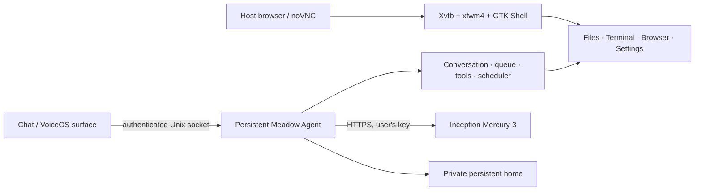

# MeadowOS

**A native Linux desktop with a persistent AI coworker.**

[繁體中文](README.zh-TW.md) · [Quick start](docs/QUICKSTART.md) · [Get an Inception API key](docs/INCEPTION.md) · [Architecture](docs/ARCHITECTURE.md)

MeadowOS brings a GTK desktop shell, real Linux applications, file previews,
a conversational Agent and an experimental VoiceOS surface into one workspace.
It runs locally in an isolated Docker desktop and uses **your own Inception
Mercury 3 API key** for AI. There is no bundled key or Meadow account requirement.

> Early developer release: Ubuntu 26.04 / X11 in a container. This repository
> builds native components; it is not a bootable ISO or a finished VM appliance.


## What is included

- A frosted desktop, shared window controls, light/dark themes and a compact Dock.
- Desktop tabs with **+ to add** and a hover **× to close**; windows move to a
  neighboring desktop rather than closing with it.
- Native Files/Thunar with content-aware folder previews, file-type icons,
  thumbnails, Quick Look and adjustable icon sizes.
- A compact chat with a floating composer, Markdown replies, background work
  records and persistent conversations.
- An Agent with filesystem, shell, desktop, browser and scheduling tools. Tools
  run in the dedicated container's desktop/workspace with full-access policy.
- A full-screen VoiceOS visual surface. Microphone/transcription/speech require
  a compatible speech backend; working Linux speech is not claimed by this release.

Mercury 3 accepts text and tools. Image drafts can be retained and previewed,
but the chat explicitly reports that this model cannot understand images.

## Run locally

Install Docker with Compose, then:

```sh
git clone https://github.com/akaiHuang/MeadowOS.git
cd MeadowOS
docker compose build --build-arg SOURCE_COMMIT="$(git rev-parse HEAD)"
docker compose up -d
```

Open [the MeadowOS desktop](http://127.0.0.1:60511/vnc.html?autoconnect=true&resize=scale).
The first source build downloads Ubuntu packages and compiles native binaries.
Ports **60511** and **60531** must be free; the launcher does not stop other
instances. The desktop starts before an AI key is configured.

### Enable Mercury 3

1. Sign up at [Inception](https://platform.inceptionlabs.ai/) and create your
   own key in its [API Keys dashboard](https://platform.inceptionlabs.ai/dashboard/api-keys).
2. Run the setup command from this project directory:

   ```sh
   docker compose exec -it meadowos python3 /usr/local/share/meadow-os/configure_inception.py
   ```

3. Paste the key at the **hidden terminal prompt**. Then follow the chat
   reconnect instructions printed by the helper.

The helper validates the official model listing and configures `mercury-3`
with tools enabled. It does not accept keys in command-line arguments, `.env`
files or build arguments. Follow the [step-by-step Chinese/English guide](docs/INCEPTION.md).
API usage is billed by Inception; current access and pricing are shown on its platform.

## Your data and keys

The repository and image contain no operator API keys, old chats or personal
runtime profiles. Your key is stored by the native credential store in the
**`meadow-home` named volume**, separately from catalog metadata, with private
file/directory permissions. `.git` and runtime credentials are excluded from
the Docker build context.

Only loopback ports are published. The container is non-root and has its own
network; the quick start mounts neither your host home nor the Docker socket.
The Agent can edit files and run programs inside this desktop. Keep that
boundary in mind before adding host mounts.

```sh
docker compose stop        # stop and retain your data
docker compose up -d       # start again
docker compose down        # remove containers/network, retain the home volume
```

`docker compose down -v` also deletes the home volume, including keys, chats
and work files.

## Architecture



The model decides what to do. The harness owns tool execution, durable state,
permissions and observed completion. Shell/Code Desktop attach to the same
Agent; they do not start separate planners. See the [component map and trust
boundaries](docs/ARCHITECTURE.md).


## Development and verification

- `packaging/meadowos/`: GTK Shell, native desktop tooling, themes, icons,
  window/folder helpers and VoiceOS assets.
- `go/`: the Linux-native Agent/Desktop dependency closure and provider setup.
- `scripts/meadowos/`: source builds, provenance validation and local tools.
- `docker/`: clean-container supervision, health checks and smoke tests.

[CI](https://github.com/akaiHuang/MeadowOS/actions) builds from the public source,
starts a fresh desktop without provider credentials, captures native Shell,
Files, Terminal and Settings windows, and checks restart persistence. Native
API setup is tested against a local mock provider, without a real API key.
A compile/smoke pass is separate from a real model task or VM boot.
Screenshots are captured from the clean desktop, not a maintainer's private session.

**Container limitation:** GNOME Web and the optional Wails Code Desktop use
WebKit. Hosts that deny nested user/mount namespaces can prevent WebKit's
sandbox from starting. CI records these capability probes separately from
the core desktop checks. The default recipe keeps sandbox protections enabled;
it does not grant privileged access to make those apps work. The native GTK
chat and hidden API setup do not depend on Wails. See [troubleshooting](docs/QUICKSTART.md).

This release focuses on the container/X11 path. Wayland, a bootable installer,
GPU performance guarantees and complete Linux speech integration are outside
its verified scope. Experimental Agent work can still need correction or
manual follow-up.

## License and credits

[Apache-2.0](LICENSE), with retained third-party notices in [NOTICE](NOTICE).
MeadowOS includes selected Meadow Code native components and original desktop
assets. Embedded frontend libraries, Raven prompt provenance and distribution
packages retain their own licenses. See [third-party notices](docs/THIRD_PARTY.md).
