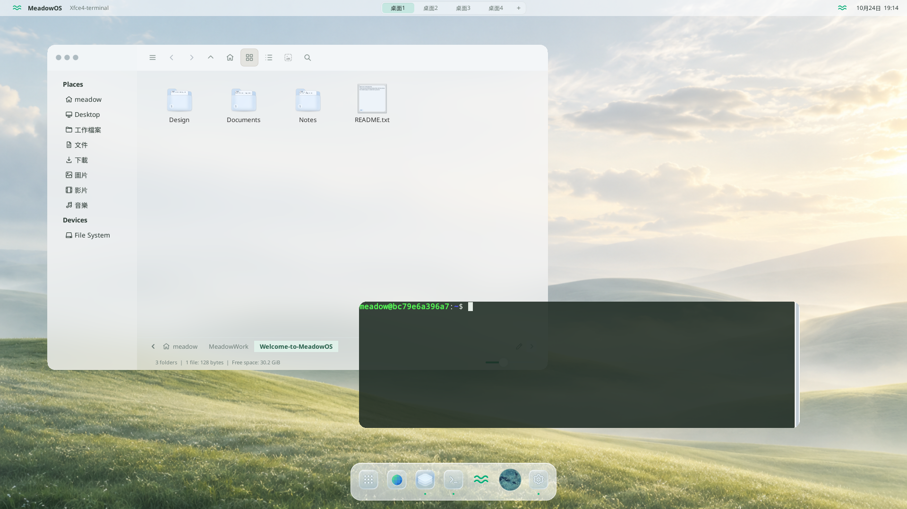
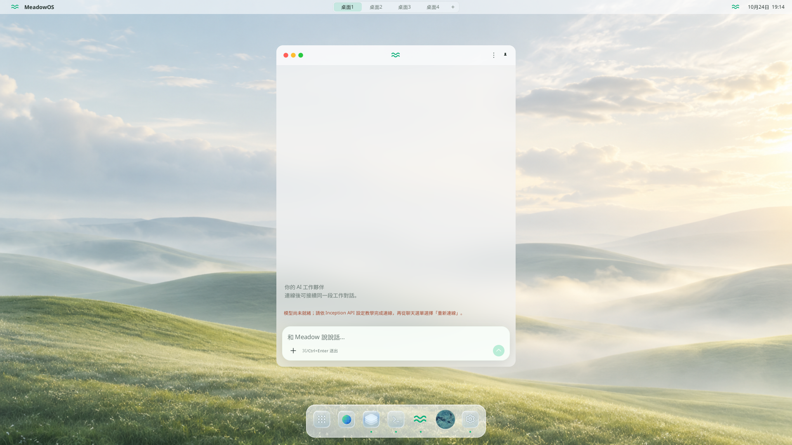
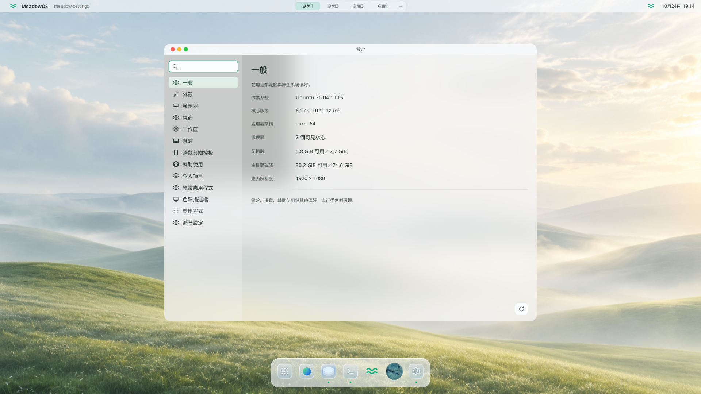

# MeadowOS

**Your desktop, with an AI coworker.**

[繁體中文](README.zh-TW.md) · [Get started](docs/QUICKSTART.md) · [Connect Inception](docs/INCEPTION.md) · [Architecture](docs/ARCHITECTURE.md)

MeadowOS brings chat, files and everyday tools into one Linux workspace.
Talk to Meadow, work with your documents and open your apps without switching
between separate environments.



## A place to work together

- **A familiar desktop.** Frosted windows, light and dark themes, a compact Dock
  and desktop tabs you can add or close.
- **An AI coworker.** Chat with Meadow and ask it to work with files, run tools
  or help with tasks. Background activity has its own work log.
- **Files at a glance.** Content-aware folder previews, thumbnails, Quick Look
  and adjustable icon sizes.
- **Room for conversation.** A compact chat window with Markdown, attachments
  and a floating composer.
- **VoiceOS preview.** An experimental full-screen visual companion. Voice input
  and speech output are not available in this Alpha.



## Get started

Install **Docker with Compose** and **Git**, then run:

```sh
git clone https://github.com/akaiHuang/MeadowOS.git
cd MeadowOS
docker compose build --build-arg SOURCE_COMMIT="$(git rev-parse HEAD)"
docker compose up -d
```

Open [MeadowOS in your browser](http://127.0.0.1:60511/vnc.html?autoconnect=true&resize=scale).
The first build takes a few minutes. Ports **60511** and **60531** must be available.

[Full setup guide →](docs/QUICKSTART.md)

## Connect Meadow

Meadow uses **Inception Mercury 3**. Create an account at
[Inception](https://platform.inceptionlabs.ai/), then create your API key in the
[API Keys dashboard](https://platform.inceptionlabs.ai/dashboard/api-keys).

With MeadowOS running, enter this command from the project folder:

```sh
docker compose exec -it meadowos python3 /usr/local/share/meadow-os/configure_inception.py
```

Paste your key at the hidden prompt. In the chat menu **⋮**, choose **重新連線**
(Reconnect). You can then start a conversation. API usage is billed by Inception.

[API setup and help →](docs/INCEPTION.md)

## Alpha availability

MeadowOS currently runs as an Ubuntu 26.04 / X11 desktop in Docker on Linux
`amd64` and `arm64`. Docker Desktop provides the Linux environment on macOS and Windows.

Mercury 3 supports text and tools; image understanding is unavailable.
GNOME Web may not start on Docker hosts that restrict WebKit's sandbox.
A bootable installer and Wayland support are not available in this release.



## Explore the project

[Architecture](docs/ARCHITECTURE.md) · [Development and tests](docs/VERIFICATION.md) ·
[Issues](https://github.com/akaiHuang/MeadowOS/issues)

[Apache-2.0](LICENSE). See [NOTICE](NOTICE) and [third-party credits](docs/THIRD_PARTY.md).
