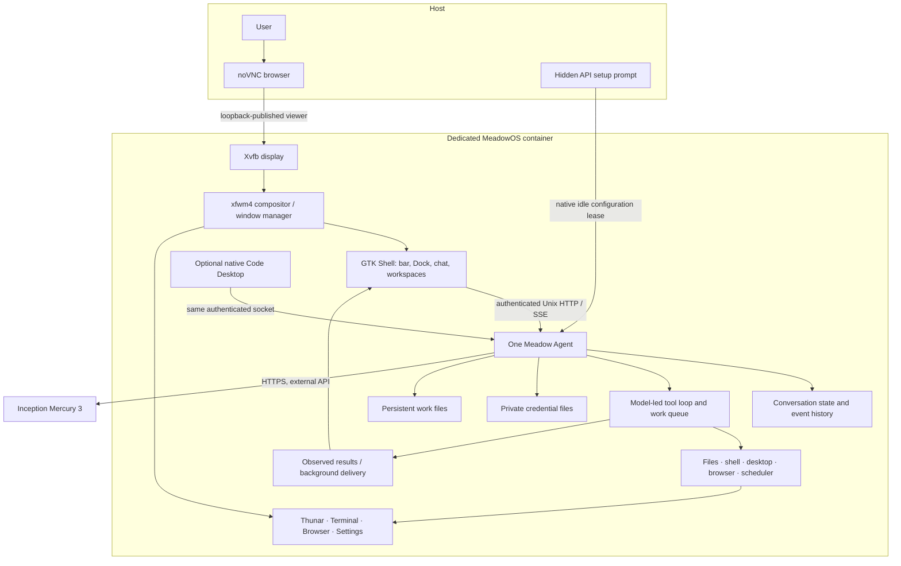

# MeadowOS architecture

MeadowOS is a native GTK/X11 desktop around one persistent Agent. The browser is
only the local remote-display client; applications execute as real Linux processes.
The current release runs inside a dedicated non-root Docker desktop.

## Components

| Component | Source | Responsibility |
| --- | --- | --- |
| Native Shell | `packaging/meadowos/shell/` | Desktop bar, Dock, conversation presentation, workspace lifecycle, draft attachments and native input |
| Window/folder resources | `packaging/meadowos/window_manager/`, `desktop/glass/` | Shared controls, native capture/frost prototypes, Thunar previews |
| Agent executable | `go/cmd/meadow-agentd/` | Single durable authority and authenticated Unix transport |
| Harness and tools | `go/core/agent/`, `go/core/serve/`, `go/core/tools/` | Context, tool calls, conversation/work queues, desktop control and scheduling |
| Provider adapter | `go/core/runtimecontrol/`, `go/core/modelconnection/` | External API catalog, credentials, immutable chat bindings and configuration leases |
| Native Code Desktop | `go/desktop/` | Optional Wails workspace; attaches to the same Agent |
| VoiceOS | `packaging/meadowos/voiceos/` | Orb/full-screen presentation and companion contracts; speech backend integration is experimental |
| Local companion | `voiceos/voice_service.py`, `docker/companion_proxy.py` | Origin/lease-bound browser IME and original image transfer into native drafts |
| Build/runtime | `scripts/meadowos/`, `docker/` | Source-bound builds, clean native process supervision and health/smoke checks |

## Task flow

1. A user message enters the native authenticated queue with a stable request identity.
2. The model reasons over the conversation and requests available tools. The
   harness does not classify natural-language requests into fixed scripted tasks.
3. Tools return observed results. Background work and scheduler wakeups retain
   their identities and state; presentation does not manufacture assistant replies.
4. Model text appears in the chat. Detailed execution observations remain in the
   work log rather than occupying the main conversation.
5. Agent work persists when the chat is hidden. Stopping the container stops its
   processes; this is not a claim of an always-online external service.

## Desktop and file UI

Desktop add/close is an acknowledged EWMH/Wnck operation. Closing a desktop moves
its windows to an adjacent survivor, compacts later desktops, and waits for native
readback; applications are not closed. The last desktop remains. Native Files
owns file actions and selection while the folder module paints bounded previews
of actual children. Rendering/adapters can vary with distribution versions.

Image originals are retained privately, transferred one at a time and represented
by compact references. Inspection is bounded and preserves per-image outcomes.
Mercury 3 has no image input; the composer shows that limitation instead of
sending an unsupported image task or claiming recognition.

## State and key boundaries

- One named home volume holds work, event history, drafts and provider settings.
- Catalog metadata and secret credential files are separate; secret files use
  `0600`, private directories `0700`.
- Inception setup validates the official HTTPS model listing, obtains a native
  whole-Agent idle lease, then uses a bounded authenticated API to store/apply
  the fixed provider route. It does not stop active work.
- Browser transfers use origin checks, foreground epochs, independent leases,
  bounded bodies and hash-checked native receipts. They do not expose Agent keys.
- Local ports bind to host loopback in Compose. No host home/Docker socket is mounted.
- Agent tool policy is full access **inside this dedicated desktop**. Source
  licensing and container boundaries are separate from provider account billing.

## Release boundary

This repository contains an allowlisted Linux source closure with fresh history.
It excludes the maintainer's private runtime, old transcripts, API keys, model
weights and unrelated private services. The retained Go module path is an internal
import namespace and does not require fetching a private Meadow repository.

Native builds carry source/binary provenance and verify the actual archive source
inventory. CI desktop screenshots and restart checks are native container evidence;
they do not prove a bootable VM, universal third-party app styling, GPU performance,
real-provider task completion or working Linux speech.

Core container acceptance covers Shell, Files, Terminal, Settings, authenticated
Agent transport and persistent home. Native provider setup is exercised with a
mock provider contract; no maintainer key is needed.
WebKit-based GNOME Web and optional Wails Desktop are separate capability probes.
Docker host restrictions on nested namespaces can block WebKit's bubblewrap
sandbox. A recognized sandbox denial is recorded as unavailable, not successful
browser rendering; unexpected failures still fail the smoke test. The release
does not disable the sandbox, add SYS_ADMIN or use privileged containers.
The GTK chat supports reconnecting and opening a new independent conversation,
so API onboarding and key rotation do not require the optional Wails app.
