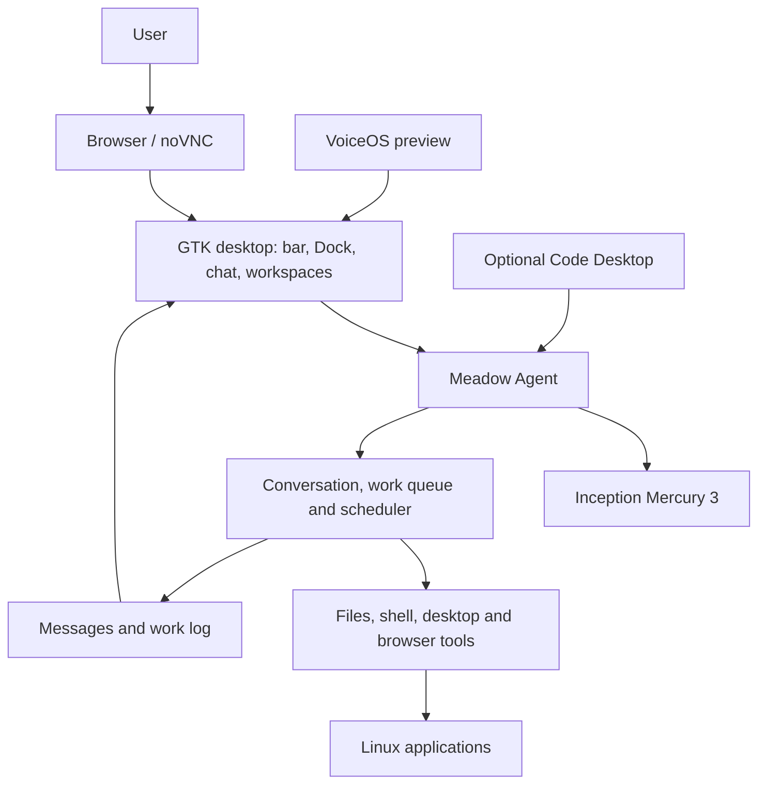

# Architecture

MeadowOS combines a native Linux desktop with a persistent Agent. The desktop
provides chat, files and apps; the Agent coordinates model requests, tool use
and background work.

## How a task moves through MeadowOS

1. The chat sends a message to the Agent.
2. The model uses the conversation context to decide what to do and which tools to request.
3. The harness executes tool calls and manages queued or scheduled work.
4. Replies appear in chat; detailed activity is available in the work log.

The Agent runs independently of the chat window, so closing the chat does not
stop ongoing work. Stopping the Docker container stops its processes.

## Components

| Component | Role | Source |
| --- | --- | --- |
| GTK Shell | Desktop bar, Dock, chat, workspaces and native input | `packaging/meadowos/shell/` |
| Window and file UI | Shared controls, glass effects and folder previews | `packaging/meadowos/window_manager/`, `packaging/meadowos/desktop/glass/` |
| Agent | Conversation service and desktop integration | `go/cmd/meadow-agentd/` |
| Harness and tools | Model loop, work queue, scheduling and tool execution | `go/core/agent/`, `go/core/serve/`, `go/core/tools/` |
| Model adapter | External model connections | `go/core/runtimecontrol/` |
| Code Desktop | Optional Wails workspace connected to the same Agent | `go/desktop/` |
| VoiceOS | Full-screen visual companion | `packaging/meadowos/voiceos/` |
| Input companion | Browser IME and image attachment transfer | `packaging/meadowos/voiceos/voice_service.py`, `docker/companion_proxy.py` |
| Build and runtime | Native builds, desktop startup and health checks | `scripts/meadowos/`, `docker/` |

## Desktop behavior

Adding or closing a desktop uses the Linux window manager. When a desktop is
closed, its windows move to a neighboring desktop; the last desktop stays open.
Files handles navigation and file actions, with folder previews based on actual
contents. The chat supports attachments, while Mercury 3 currently accepts
text and tools only.

## Runtime

The Alpha uses Ubuntu 26.04, X11, Xvfb and xfwm4 inside Docker. Native GTK apps
run in that environment, and noVNC displays the desktop in a host browser.
The default setup is local and does not mount the host home or Docker socket.

VoiceOS is a visual preview; Linux speech integration is not available in this
release. WebKit-based applications depend on host sandbox support. See the
[setup guide](QUICKSTART.md) for current requirements and limitations, or
[development and tests](VERIFICATION.md) to contribute.
